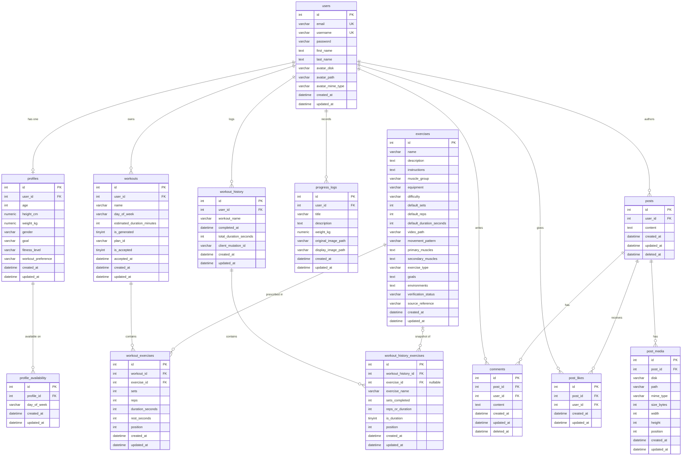

# SyncroFit Entity Relationship Diagram

This document describes the SyncroFit relational schema after the 3NF
normalization (migration `2026_10_26_000001_normalize_schema_to_3nf`). It is
generated from the live migrated schema, so every table, column, and foreign
key below is traceable to an actual database constraint.

Framework-internal tables (`migrations`, `cache`, `cache_locks`, `jobs`,
`job_batches`, `failed_jobs`, `password_reset_tokens`, `sessions`,
`personal_access_tokens`) are intentionally omitted — they are not part of the
domain model.

## Diagram

## Relationships

| Parent | Child | Cardinality | FK column | On delete |
| --- | --- | --- | --- | --- |
| users | profiles | 1 : 0..1 | profiles.user_id | CASCADE |
| users | workouts | 1 : 0..N | workouts.user_id | CASCADE |
| users | workout_history | 1 : 0..N | workout_history.user_id | CASCADE |
| users | progress_logs | 1 : 0..N | progress_logs.user_id | CASCADE |
| users | posts | 1 : 0..N | posts.user_id | CASCADE |
| users | comments | 1 : 0..N | comments.user_id | CASCADE |
| users | post_likes | 1 : 0..N | post_likes.user_id | CASCADE |
| profiles | profile_availability | 1 : 0..N | profile_availability.profile_id | CASCADE |
| workouts | workout_exercises | 1 : 0..N | workout_exercises.workout_id | CASCADE |
| exercises | workout_exercises | 1 : 0..N | workout_exercises.exercise_id | CASCADE |
| workout_history | workout_history_exercises | 1 : 0..N | workout_history_exercises.workout_history_id | CASCADE |
| exercises | workout_history_exercises | 1 : 0..N (optional) | workout_history_exercises.exercise_id | SET NULL |
| posts | comments | 1 : 0..N | comments.post_id | CASCADE |
| posts | post_likes | 1 : 0..N | post_likes.post_id | CASCADE |
| posts | post_media | 1 : 0..N | post_media.post_id | CASCADE |

## Unique constraints

- `users` — `email`, `username`
- `profile_availability` — (`profile_id`, `day_of_week`)
- `workout_exercises` — (`workout_id`, `position`)
- `workout_history` — (`user_id`, `client_mutation_id`) — enforces idempotent
  offline sync of completed sessions
- `post_likes` — (`post_id`, `user_id`) — one like per user per post
- `post_media` — (`post_id`, `position`)

## Normalization notes (3NF)

The `2026_10_26_000001_normalize_schema_to_3nf` migration eliminated repeating
groups and derived/transitive columns that previously violated normal form:

1. **`profile_availability`** replaces the former JSON `profiles.availability_days`
   column. Each available weekday is now its own row with a real FK to
   `profiles`, removing a multi-valued attribute (1NF/2NF) and making
   availability queryable and referentially traceable.

2. **`workout_exercises`** replaces the former JSON `workouts.exercises` column.
   Each prescribed exercise is a row with a non-null FK to `exercises`
   (`onDelete=CASCADE`) plus the per-exercise prescription (`sets`, `reps`,
   `duration_seconds`, `rest_seconds`, `position`). `position` is unique per
   workout to preserve ordering.

3. **`workout_history_exercises`** replaces the former JSON
   `workout_history.exercises_completed` column. It keeps a **nullable** FK to
   `exercises` (`onDelete=SET NULL`) alongside a denormalized `exercise_name`
   snapshot. The snapshot is deliberate: historical records must remain
   human-readable even if the catalog exercise is later removed — deleting an
   exercise nulls the FK but preserves the recorded `exercise_name`, sets, and
   reps/duration. This is intentional historical-fact retention, not a 3NF
   violation.

4. **`profiles.bmi`** was dropped. BMI is a transitive dependency
   (derivable from `height_cm` and `weight_kg`), so it is now a computed
   accessor on the `Profile` model rather than a stored column.

### API contract preservation

Although storage is normalized, the external JSON/API contract is unchanged.
Eloquent models re-expose the former shapes as virtual attributes backed by the
new relations:

- `Profile.availability_days` ← `profile_availability`
- `Profile.bmi` ← computed from `height_cm` / `weight_kg`
- `Workout.exercises` ← `workout_exercises`
- `WorkoutHistory.exercises_completed` ← `workout_history_exercises`

The Flutter client, offline SQLite cache, and serialization therefore require no
changes.

---

_Generated from the migrated schema on 2026-10-26. To regenerate, run all
migrations against a scratch database and introspect the resulting tables,
columns, and foreign keys._
